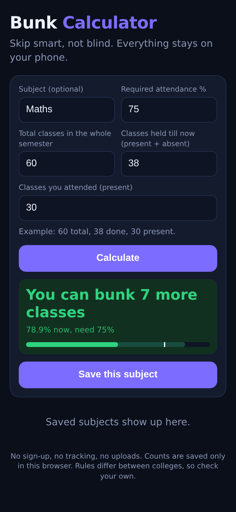

# Bunk Calculator

**Skip smart, not blind.** Tell it the semester total, how many classes are done and how many you attended. It tells you how many classes you can still bunk and still hit your required attendance.

**Live:** https://nameabuser.github.io/bunk-calculator/

## What it does

Enter four things:

1. Total classes in the whole semester
2. Classes held till now (present + absent)
3. Classes you attended (present)
4. Attendance % your college needs (75% by default)

Example: the semester has 60 classes, 38 are done and you were present in 30. At 75% you need to attend 45 of the 60, so you can still bunk 7 more classes out of the 22 left.

- If you can still bunk: it tells you how many more.
- If you are on the edge: it tells you to attend every remaining class.
- If it is too late: it tells you the best percentage you can still reach.
- Save subjects, then tap "Attended today" or "Bunked today" to update the counts.

## The maths

With `S` classes in the semester, `H` held, `A` attended and `r` percent required:

- Classes you must attend in total = ceil(S x r / 100)
- Classes left = S - H
- Bunks left = A + (S - H) - ceil(S x r / 100)
- Best you can reach = (A + S - H) / S

## Privacy

No sign-up, no server, no tracking. Your numbers are saved only in your own browser (localStorage).

## Limits

It does a simple attendance percentage. It does not know your college's special rules such as medical leave, condonation, or rounding. Check your own rules before you bunk for real.

## Run it yourself

It is a single `index.html` file. Open it in a browser, or host it on GitHub Pages.
